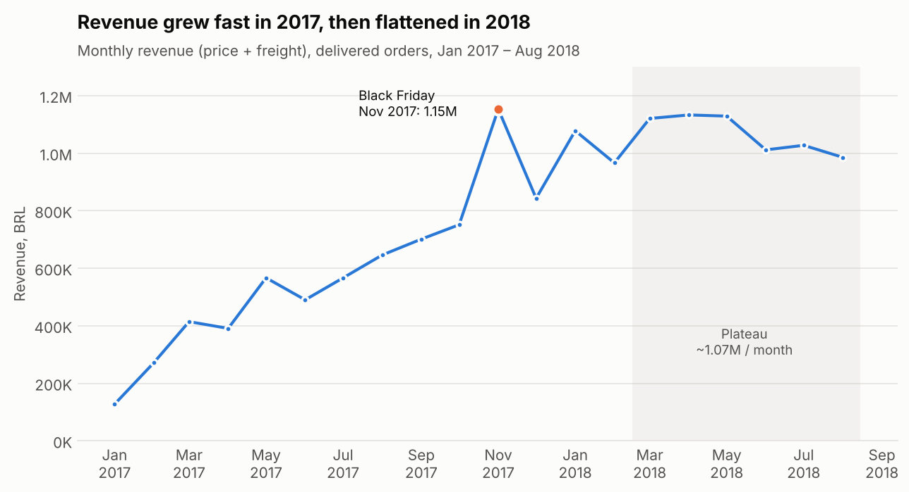
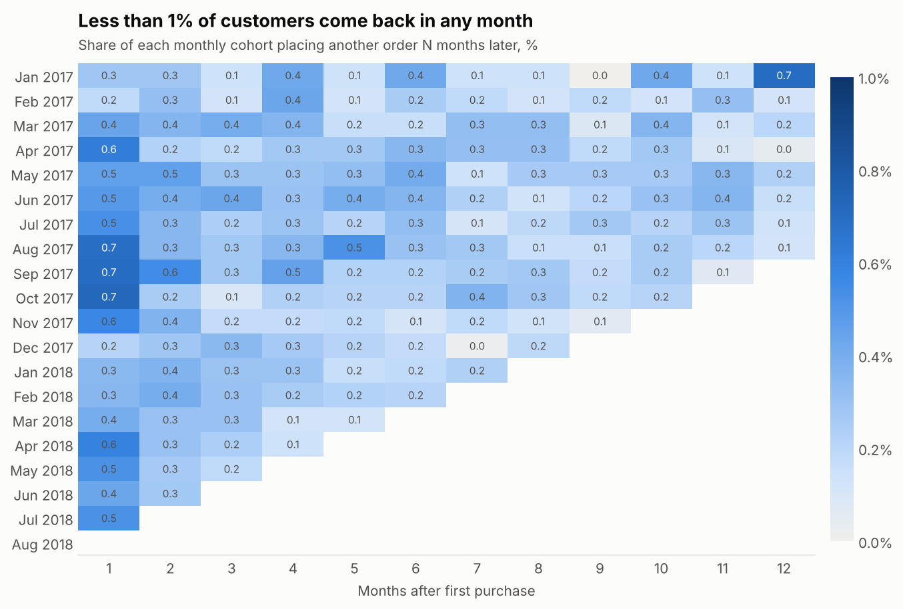
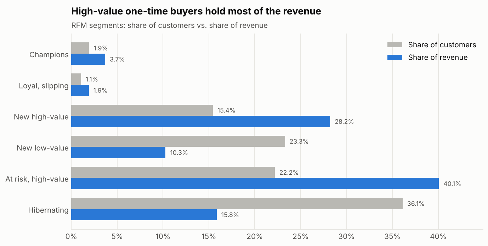
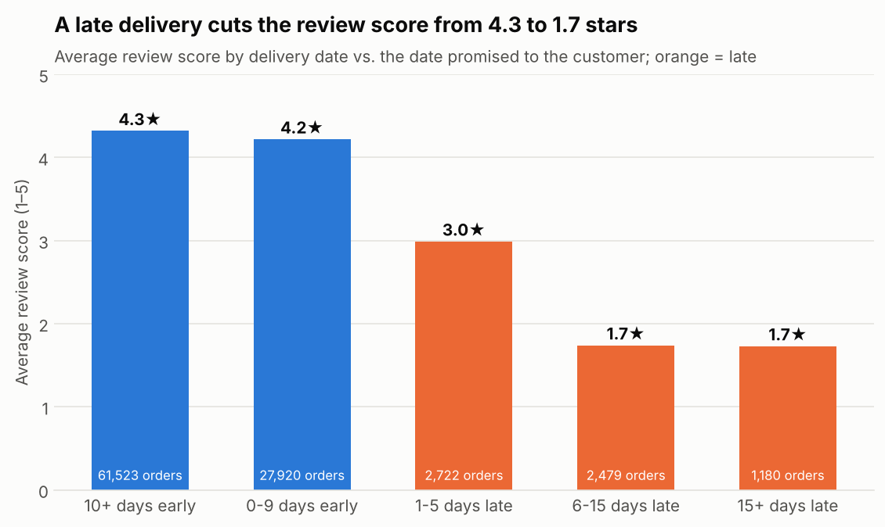
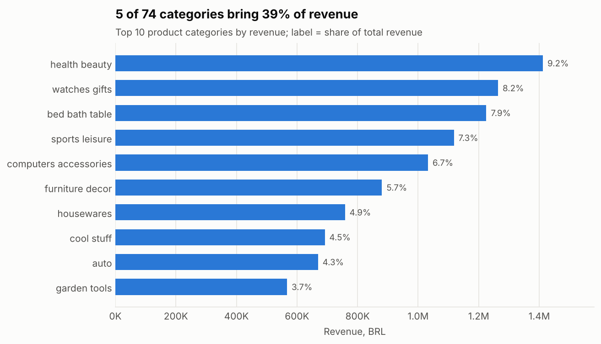
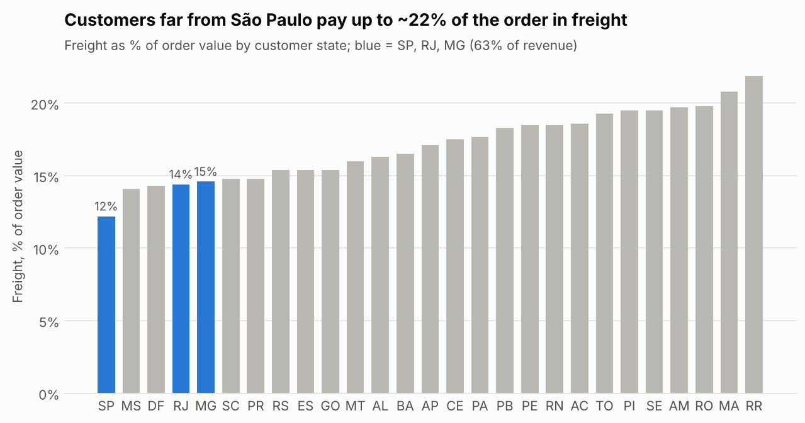

# Olist E-commerce Analysis

**Why does a fast-growing marketplace stop growing?**
An end-to-end analysis of ~100k orders from **Olist**, the largest department store on Brazilian marketplaces (2016–2018):
data cleaning in Python, a relational model in **PostgreSQL**, 10 analytical SQL queries, customer segmentation (RFM)
and cohort retention.


## Key results

| Metric | Value |
| --- | --- |
| Delivered orders analysed | 96,470 |
| Unique customers | 93,350 |
| Revenue (price + freight) | 15.4M BRL |
| Average order value | 160 BRL |
| Customers who bought twice | **3.0%** |
| Late deliveries | 6.8% |
| Review score: on time vs. 5+ days late | **4.3 vs. 1.7** |

**Main conclusion:** Olist grew in 2017 purely by acquiring new customers. Almost none of them come back
(3% repeat rate, under 1% monthly retention), so when acquisition slowed in 2018, revenue flattened at ~1.07M BRL a month.
The biggest levers are **winning back high-value one-time buyers** (40% of revenue) and **fixing late deliveries**,
which turn a 4.3-star experience into a 1.7-star one.

## Findings

### 1. Growth stopped in 2018



- Monthly revenue grew ~8× during 2017 (average +26% month over month), peaking on **Black Friday, Nov 2017 (1.15M BRL)**.
- From March 2018 revenue is **flat at ~1.07M BRL per month** (average MoM growth +0.6%).
- Average order value stayed in a narrow 146–170 BRL band, so all growth came from **order volume, not basket size**.

### 2. Customers almost never come back



- Only **2,801 of 93,350 customers (3.0%)** placed a second order.
- In every monthly cohort, **fewer than 1% of customers buy again in any following month** (month-1 average: 0.48%).
- Retention does not improve for newer cohorts, so the problem is structural, not seasonal.

### 3. Most revenue sits with one-time high-value buyers



| Segment | Customers | Revenue share | Avg. spend |
| --- | --- | --- | --- |
| Champions (repeat, recent) | 1.9% | 3.7% | 315 BRL |
| Loyal, slipping (repeat, not recent) | 1.1% | 1.9% | 296 BRL |
| New high-value (1 order, recent, big basket) | 15.4% | 28.2% | 302 BRL |
| New low-value | 23.3% | 10.3% | 73 BRL |
| **At risk, high-value** (1 big order, long ago) | 22.2% | **40.1%** | 298 BRL |
| Hibernating | 36.1% | 15.8% | 72 BRL |

- Repeat buyers spend about **2× more** per person than the average customer, but they are only 3% of the base.
- **"At risk, high-value"** customers placed one large order ~11 months ago and never returned: **40% of all revenue**.

### 4. Late delivery destroys satisfaction



- On-time orders average **4.3 stars**; orders 6+ days late average **1.7 stars**, and 78% of them get 1–2 stars.
- Even a 1–5 day delay drops the score to 3.0.
- Only 6.8% of orders are late, but they generate a large share of all negative reviews.

### 5. Revenue is concentrated, and remote customers pay heavily for shipping





- **5 of 74 categories bring 39% of revenue** (health & beauty, watches & gifts, bed & bath, sports, computers).
- **São Paulo, Rio de Janeiro and Minas Gerais = 63% of revenue.**
- Freight is 12% of the order value in São Paulo but up to **22%** in northern states, where customers place larger
  orders (AOV 200–270 BRL). Expensive shipping is a likely barrier to growth outside the South-East.

## Recommendations

| # | Action | Target | Why |
| --- | --- | --- | --- |
| 1 | **Win-back campaign** (personal offer, free shipping on the 2nd order) | "At risk, high-value", 20.7k customers | 40% of revenue, proven willingness to spend ~300 BRL |
| 2 | **Second-purchase trigger** 30–60 days after the first order | "New high-value", 14.4k customers | Convert before they slip into "at risk" |
| 3 | **Delivery reliability**: realistic delivery estimates, proactive alerts and compensation when an order will be late | All orders, focus on the 6.8% late | Late orders score 2.0 stars lower on average (2.6 when 6+ days late) |
| 4 | **Regional shipping subsidy / partner logistics** in the North and North-East | Customers in high-freight states | Freight up to 22% of the basket suppresses demand |
| 5 | **Track retention as a core KPI** (repeat rate, month-1 retention by cohort) | Management dashboard | Growth by acquisition alone has already stalled |

**Suggested A/B test:** offer free shipping on the second order to half of new high-value customers and compare
the 60-day repeat rate. A lift from 3% to 5% would add roughly 290 extra orders per 14.4k customers (~86k BRL at 300 BRL each).

## Methodology

1. **Data quality check** (`01_load.ipynb`): sizes, types, missing values, duplicates, key integrity.
2. **Cleaning** (`02_cleaning.ipynb`): delivered orders only, dates converted, latest review per order,
   untranslated categories fixed, delivery features (`delivery_days`, `delay_days`, `is_late`) added.
3. **Database** (`sql/schema.sql`, `src/build_db.py`): 6 tables with primary keys, foreign keys, `CHECK`
   constraints and indexes; bulk load with `COPY`.
4. **SQL analysis** (`03_sql_analysis.ipynb`, `sql/01–10`): CTEs, window functions (`LAG`, `RANK`, `NTILE`,
   `SUM() OVER`), `FILTER`, `PERCENTILE_CONT`, cohort logic with `AGE`.
5. **Metrics & charts** (`04_metrics.ipynb`): RFM segments, cohort heatmap, final charts.

**Key definitions**

- **Revenue** = `price + freight_value` from order items (payments differ in only 0.26% of orders and cannot be split by category).
- **Customer** = `customer_unique_id`. `customer_id` is created per order, so using it would hide every repeat purchase.
- **Trend period** = Jan 2017 – Aug 2018 (2016 has only ~270 orders with gaps).
- **Late delivery** = delivered after the date promised to the customer.
- **RFM**: R and M are quintiles; F is scored 1 / 2 / 3+ orders, because 97% of customers have exactly one order
  and quintiles would split identical customers into different groups.

**Limitations:** the data covers only delivered orders and ends in Aug 2018; review scores are available for 99% of orders;
the relationship between late delivery and retention is a correlation, which the suggested A/B test would confirm.

## Project structure

```
olist-ecommerce-analysis/
├── data/
│   ├── raw/                  # original CSV files (not tracked by Git)
│   └── processed/            # cleaned tables (not tracked by Git)
├── notebooks/
│   ├── 01_load.ipynb         # first look & data quality
│   ├── 02_cleaning.ipynb     # cleaning & preparation
│   ├── 03_sql_analysis.ipynb # 10 SQL queries against PostgreSQL
│   └── 04_metrics.ipynb      # RFM, cohorts, charts
├── sql/
│   ├── schema.sql            # tables, keys, constraints, indexes
│   └── 01–10_*.sql           # one file per analytical query
├── src/
│   ├── build_db.py           # loads clean data into PostgreSQL
│   └── db.py                 # connection helper used by the notebooks
├── reports/figures/          # charts used in this README
├── docker-compose.yml
├── .env.example
└── requirements.txt
```

Database relationships:

```
customers ──< orders ──< order_items >── products
                 ├──< order_payments
                 └──── order_reviews (1 : 0..1)
```

## How to run

1. Download the dataset from [Kaggle](https://www.kaggle.com/datasets/olistbr/brazilian-ecommerce) and unzip the 9 CSV files into `data/raw/`.
2. Start PostgreSQL — choose **one** option:
   - **Docker** (no local install needed):
     ```bash
     cp .env.example .env
     docker compose up -d
     ```
   - **Local PostgreSQL** (14+): create the user and database, then copy `.env.example` to `.env`
     and adjust the values if yours differ:
     ```sql
     CREATE USER olist WITH PASSWORD 'olist';
     CREATE DATABASE olist OWNER olist;
     ```
3. Install dependencies:
   ```bash
   python -m venv .venv
   source .venv/bin/activate        # Windows: .\.venv\Scripts\Activate.ps1
   pip install -r requirements.txt
   ```
4. Run `notebooks/01_load.ipynb` and `notebooks/02_cleaning.ipynb` — the second one writes clean files to `data/processed/`.
5. Load the clean data into PostgreSQL (recreates all tables, ~15–30 s):
   ```bash
   python src/build_db.py
   ```
6. Run `notebooks/03_sql_analysis.ipynb` and `notebooks/04_metrics.ipynb`.

## Data source

[Brazilian E-Commerce Public Dataset by Olist](https://www.kaggle.com/datasets/olistbr/brazilian-ecommerce), CC BY-NC-SA 4.0.
Monetary values are in Brazilian reais (BRL).
